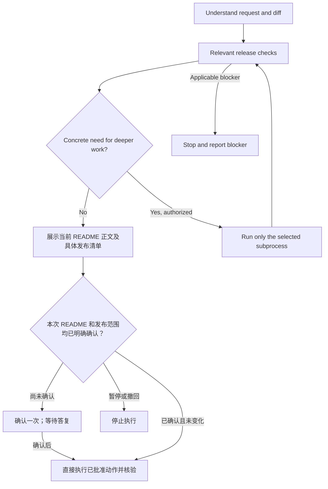

# Default Publication Flow

This is the routing authority for ordinary releases. Detailed writing, engineering and acceptance references are conditional procedures, not a mandatory chain. Explicit user restrictions and [authorization.md](authorization.md) always apply; reuse unchanged identity/attribution decisions through [review-decisions.md](review-decisions.md), never as publication approval.

## Short default

1. **Understand the request and change.** Identify project type, release target, diff and existing project-required checks. Detect Publisher’s own Node.js and Git requirements; detect gh only for selected remote operations. Missing tools require guidance and authorized installation followed by rechecking. Read enough to understand what is being published; do not perform a comprehensive diagnosis by default. Keep existing useful project layout, license and README languages unless a relevant change or explicit instruction requires work.
2. **Check what matters to this release.** Review the actual delivery/staged/tracked content for secrets, private/local-only files, missing required files, material rights/identity issues and new hidden dependencies. Check affected documentation, links and approved preview scope; a code-only update need not rewrite a correct README or regenerate an unchanged approved visual. Run existing mandatory checks and affected native tests, after reviewing side effects and execution authorization. Reuse relevant evidence only for unchanged inputs/environment; rerun affected checks after edits. A normal app/library/CLI does not inherit Skill layout or Publisher's own README framework. The bundled publish-check is Skill-oriented by default; for a non-Skill project use `--profile=generic` (safety, rights and identity scans only), never the Skill profile. A known applicable failure stays blocking; the short flow must not waive it. 发布 Skill 还须满足开箱即用及 Windows／macOS 至少一端实测、另一端审查适配的最低标准，详见 [skill-completeness.md](skill-completeness.md) 和 [platform-compatibility.md](platform-compatibility.md)。有效证据可复用，只补受影响项；验证状态只写内部报告，README 只写有助于安装、配置和使用的信息。
3. **发布前清单（Final Pre-publish Summary）：先展示 README，再确认内容与范围。** 每次发布前必须实际展示当前待发布的 README 正文（有中文时优先完整中文版），等待用户明确确认；只给文件路径／链接、检查结论、截图或摘要不算展示。可与最终发布范围合并为一次确认；同一次发布内容未变不重复询问，但不能跨发布复用其他版本的 README 确认。正文、关键链接或内嵌图片变化后须重新展示变化后的内容并确认，详见 [authorization.md](authorization.md)。新增第三方署名或许可说明必须在聊天摘要里写明来源、文件、拟公开内容和许可条件，取得针对这些内容的明确确认；不能只放附件，也不能用笼统的“发布吧”代替。可与推送范围合并明确确认一次；已确认且未变则复用。 Include the GitHub account and permission, Git author/name/email when commits are involved, existing license or unresolved rights, repository URL, branch, visibility, exact commits/change summaries, candidate digest, requested remote actions, relevant check outcomes and material untested scope. Reuse unchanged confirmed facts; do not ask the same identity questions again. User acceptance of limitations must be explicit and cannot waive secrets, ownership or authorization blockers. If no final commit list is ready, prepare it as authorized before asking for push confirmation. Never request tokens in chat.
4. **执行已确认的发布范围（Publish to GitHub），然后核验。** 只有本次 README 内容与具体发布范围均已明确确认，才执行远程动作。发布范围说清楚后确认一次；同一次发布已经确认过且范围和 README 均没变，就直接执行，不要反复问。若尚未确认，等待用户明确确认上述清单。确认后只执行列出的动作，再核对相关远程提交、内容、公开性和元数据。 Push permission does not include an unlisted tag/Release. Changed content, target or actions require renewed confirmation; a hold takes precedence. An inspect/edit-only request never reaches remote execution.

## 核心任务与 README 示例验证

这两项属于快速发布的必要检查，不自动扩展为全面工程诊断：

- **核心任务**：首次发布、核心流程变化或缺少适用证据时，实际跑通至少一个最常见的用户任务，确认能够加载／启动、执行并得到有效结果；不能只看脚本退出码或文件是否生成。
- **README 示例**：首次发布、新增／修改示例或相关功能变化时，逐一验证可执行操作示例（包括安装命令、脚本、API 调用及完整任务），核对结果与说明一致。自然语言提示覆盖不同的核心使用方式，同义重复可选代表项；截图和展示性输出核对真实来源及当前功能一致性，合成素材不得冒充实际成果。
- **安全边界**：涉及真实发布、付费、删除或账号写入的任务／示例，使用预览、沙盒或模拟验证，并如实记录未实际执行的范围；测试不授权真实副作用、依赖安装或超范围操作。模拟不能冒充端到端实测；若关键路径仍缺少必要证据，报告缺口并处理后再判断可否发布。
- **复用与记录**：未变化且环境、依赖和相关行为仍适用的有效证据可以复用，只补测受影响或缺证据的项。验证状态、证据来源、复用依据及缺口只写内部报告，不写入 README；README 仅保留准确可用的示例和必要使用条件。失败或关键缺口须处理，不得忽略后判为可发布。

No minimum number of commands or test runs is required. Keep one concise result; do not generate a separate engineering scorecard, cost report or rubric for an ordinary release. No automatic external evaluator, other Skill, installation or auxiliary Agent.

## Optional subprocesses

| Subprocess | Trigger | Boundary / return |
|---|---|---|
| Understand / engineering diagnosis | User asks, or a concrete consequential issue needs diagnosis | Read relevant `project-analysis.md`; isolate the issue, report evidence and a scoped remedy, then return. Do not conduct a whole-project audit for a minor concern. |
| Performance / Token measurement | User explicitly requests it, or agrees to a proposed measurement of an observed bottleneck | Define inputs, quality requirements, available metrics and a small budget first. Record cached/noncached input, output and elapsed time only when available; unknown stays unknown. No automatic repeated A/B or money-saving claims. |
| Optimization and regression | A worthwhile issue is identified and changes are authorized | Preserve the original/user edits; fix the selected issue, run the same relevant checks, measure if benefit is claimed and retain/revert based on evidence. No unrelated rewrite or automatic installation. |
| Fresh installation / full acceptance | Installation method, delivery contents, dependencies or core flow materially change; a support claim expands; or user/project explicitly requires it | Use `acceptance.md` only for applicable scope. Once selected, required failures/unknowns stay unresolved; never relabel an old required failure as optional to release. |
| Compatibility review | A change affects platform behavior or support claims, or user/project requires it | Use `platform-compatibility.md` for declared/affected platforms. Do not automatically test all clients/OS for a documentation-only update. Distinguish runtime testing from review; the Skill minimum is one OS tested and the other reviewed/adapted, with valid evidence reusable. |
| README / preview preparation | Documentation/material is missing, misleading, affected by the change, or explicitly requested | Read the relevant writing/visual section of `publishing-workflow.md`; preserve approved unchanged material and project-appropriate conventions. |

Before a selected subprocess starts, briefly state its problem, scope, expected work/cost and stop point. Request permission only for work not already authorized. A subflow result returns here; it does not trigger the next subflow automatically. If evidence is insufficient, stop that work and report the gap rather than expanding it indefinitely.

Stop when the release-relevant result is known. Recheck affected facts after a fix; unchanged checks need no repeated run. Broad engineering, full regression, benchmarks and multiple model runs are not default publication requirements.
