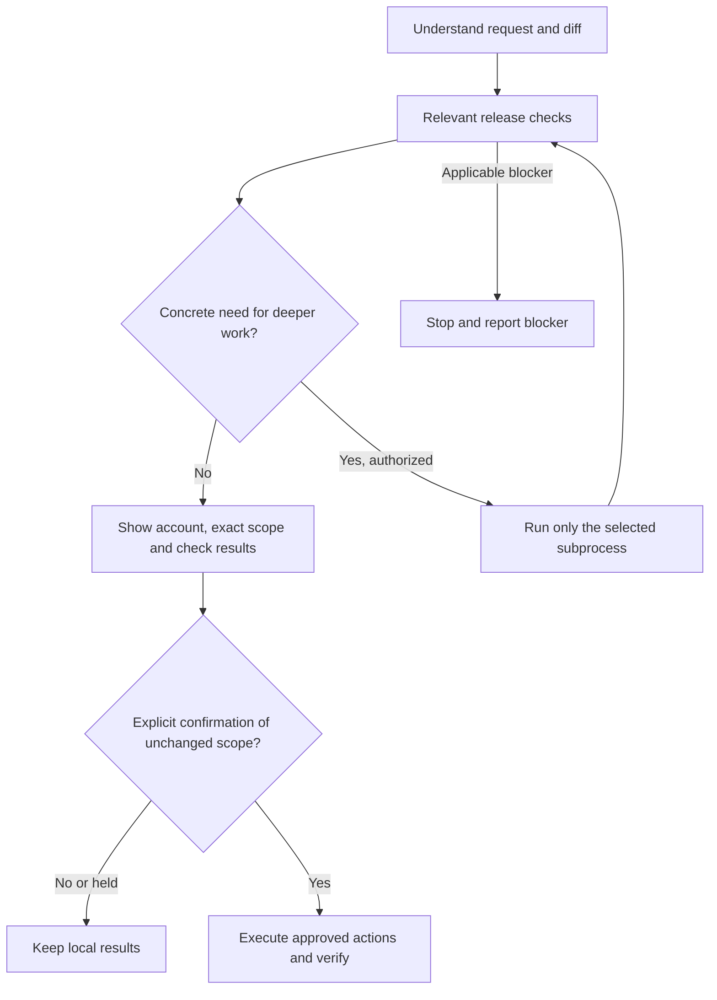

# Default Publication Flow

This is the routing authority for ordinary releases. Detailed writing, engineering and acceptance references are conditional procedures, not a mandatory chain. Explicit user restrictions and [authorization.md](authorization.md) always apply; reuse unchanged identity/attribution decisions through [review-decisions.md](review-decisions.md), never as publication approval.

## Short default

1. **Understand the request and change.** Identify project type, release target, diff and existing project-required checks. Read enough to understand what is being published; do not perform a comprehensive diagnosis by default. Keep existing useful project layout, license and README languages unless a relevant change or explicit instruction requires work.
2. **Check what matters to this release.** Review the actual delivery/staged/tracked content for secrets, private/local-only files, missing required files, material rights/identity issues and new hidden dependencies. Check affected documentation, links and approved preview scope; a code-only update need not rewrite a correct README or regenerate an unchanged approved visual. Run existing mandatory checks and affected native tests, after reviewing side effects and execution authorization. Reuse relevant evidence only for unchanged inputs/environment; rerun affected checks after edits. A normal app/library/CLI does not inherit Skill layout or Publisher's own README framework. The bundled publish-check is Skill-oriented: use it where applicable, not as a universal project gate. A known applicable failure stays blocking; the short flow must not waive it.
3. **Final Pre-publish Summary: show one concrete summary and wait.** Include the GitHub account and permission, Git author/name/email when commits are involved, existing license or unresolved rights, repository URL, branch, visibility, exact commits/change summaries, candidate digest, requested remote actions, relevant check outcomes and material untested scope. Reuse unchanged confirmed facts; do not ask the same identity questions again. User acceptance of limitations must be explicit and cannot waive secrets, ownership or authorization blockers. If no final commit list is ready, prepare it as authorized before asking for push confirmation. Never request tokens in chat.
4. **Publish to GitHub only for the confirmed scope, then verify.** After explicit human confirmation of that summary, execute only listed actions, then verify remote commits/content, visibility and metadata as relevant. Push permission does not include an unlisted tag/Release. Changed content, target or actions require renewed confirmation; a hold takes precedence. An inspect/edit-only request never reaches remote execution.

No minimum number of commands or test runs is required. Keep one concise result; do not generate a separate engineering scorecard, cost report or rubric for an ordinary release. No automatic external evaluator, other Skill, installation or auxiliary Agent.

## Optional subprocesses

| Subprocess | Trigger | Boundary / return |
|---|---|---|
| Understand / engineering diagnosis | User asks, or a concrete consequential issue needs diagnosis | Read relevant `project-analysis.md`; isolate the issue, report evidence and a scoped remedy, then return. Do not conduct a whole-project audit for a minor concern. |
| Performance / Token measurement | User explicitly requests it, or agrees to a proposed measurement of an observed bottleneck | Define inputs, quality requirements, available metrics and a small budget first. Record cached/noncached input, output and elapsed time only when available; unknown stays unknown. No automatic repeated A/B or money-saving claims. |
| Optimization and regression | A worthwhile issue is identified and changes are authorized | Preserve the original/user edits; fix the selected issue, run the same relevant checks, measure if benefit is claimed and retain/revert based on evidence. No unrelated rewrite or automatic installation. |
| Fresh installation / full acceptance | Installation method, delivery contents, dependencies or core flow materially change; a support claim expands; or user/project explicitly requires it | Use `acceptance.md` only for applicable scope. Once selected, required failures/unknowns stay unresolved; never relabel an old required failure as optional to release. |
| Compatibility review | A change affects platform behavior or support claims, or user/project requires it | Use `platform-compatibility.md` for declared/affected platforms. Do not automatically test all clients/OS for a documentation-only update. Never claim untested support. |
| README / preview preparation | Documentation/material is missing, misleading, affected by the change, or explicitly requested | Read the relevant writing/visual section of `publishing-workflow.md`; preserve approved unchanged material and project-appropriate conventions. |

Before a selected subprocess starts, briefly state its problem, scope, expected work/cost and stop point. Request permission only for work not already authorized. A subflow result returns here; it does not trigger the next subflow automatically. If evidence is insufficient, stop that work and report the gap rather than expanding it indefinitely.

Stop when the release-relevant result is known. Recheck affected facts after a fix; unchanged checks need no repeated run. Broad engineering, full regression, benchmarks and multiple model runs are not default publication requirements.
